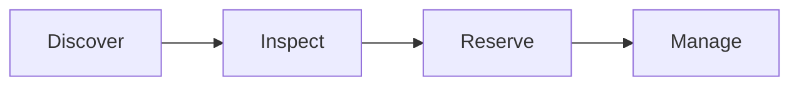

# LibraryLens

A library discovery and reservation prototype with searchable books, detail pages, a library map, and an Android project powered by Capacitor.

**Status:** Coursework prototype · Local reservation storage.

[Portfolio case study](https://debayan-cyberx.github.io/Deb-s-Portfolio.github.io/#project-library)

## Problem and intended user

Give students a compact interface for browsing books, exploring library information, and managing a sample reservation flow.

## My implementation

I implemented the complete application and Android integration. Teammates handled supporting research and presentations; the original Figma design is credited in the repository.

## Stack and workflow

React, TypeScript, Capacitor, Android.



## Walkthrough

1. Search the catalog by title or author and narrow results by genre.
2. Open a book detail page and start a reservation with sample student information.
3. Review active reservations and their expiry in the profile view.
4. Explore the library map or open the Capacitor Android project for the mobile experience.

## Run locally

Install Node.js and npm, clone this repository, then run:

```sh
npm ci
npm run dev
```

Use the local URL printed by Vite. To build the web app:

```sh
npm run build
```

For Android, install Android Studio and the required Android SDK, then synchronize the built assets:

```sh
npx cap sync android
npx cap open android
```

The Capacitor configuration uses `dist` as its web directory. Android device/emulator execution requires the Android toolchain; running the web app does not require it.

## Technical decision and tradeoff

Share a React interface across web and an Android Capacitor wrapper. Local storage makes reservations easy to demonstrate, but does not synchronize stock or bookings across devices.

## Current limitations

Reservations are stored locally in the browser. There is no demonstrated connection to a real library inventory or shared reservation backend.

## Validation scope

The repository has a Vite build command and Android scaffold tests. It does not include a dedicated automated test suite for the reservation workflow. Validation commands are provided for reproduction; this documentation update does not claim new test runs or production measurements.

## Design and asset credits

The original design is available in [Figma](https://www.figma.com/design/I8LVG7BcCpRUsRDxy2Nswk/LibraryLens-App-Development). Retained component and photography attributions are listed in [ATTRIBUTIONS.md](ATTRIBUTIONS.md).
